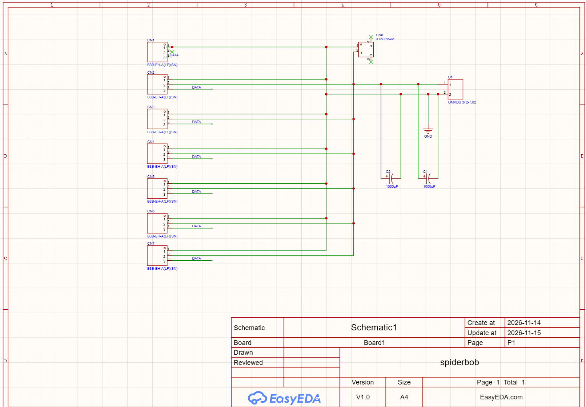
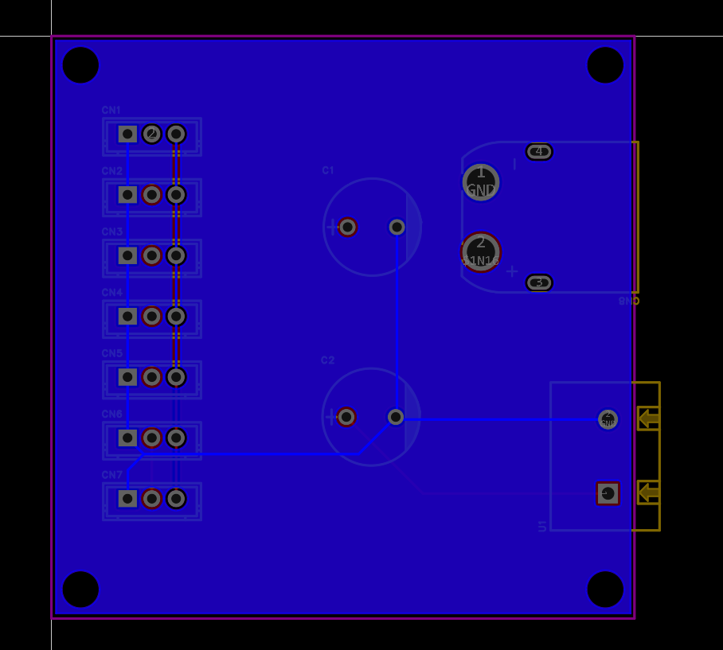
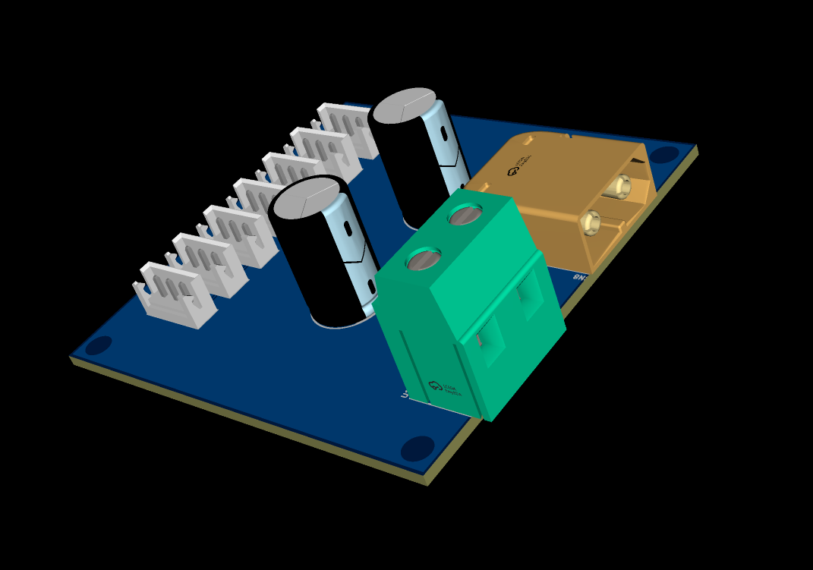
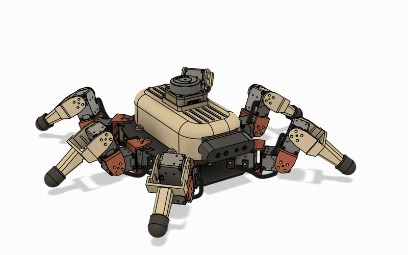

# spiderbob

**spiderbob is a project combining robotics and artificial intelligence.**

---

## Table of Contents / Sommaire

- [Goal of spiderbob](#goal-of-spiderbob)
- [Logbook](#logbook)

---

## Goal of spiderbob

- The main objective of spiderbob is to improve my skills in mobile robotics and AI following the [DeepSight-Nebula](https://github.com/TheValll/DeepSight-Nebula) project.

---

## Logbook

In this section, I'll document my project, take notes, post results, and reflect on my work.

### 11/13/2026

I started by assessing the project's feasibility and budget. My current plan is an autonomous hexapod with three degrees of freedom per leg, 18 servomotors, a 3D camera, and a 360° LiDAR.

I found a used [Intel RealSense D435i](https://www.realsenseai.com/products/depth-camera-d435i/) on Leboncoin for €200, compared with an observed new price of €538.80.

#### LiDAR comparison

I compared multiple lidar; for my usage, the SLAMTEC RPLIDAR C1 has the best compromise.

| Manufacturer | Model       | Advertised maximum range | Price considered | Notes                                                                 | Official link                                                                        |
| ------------ | ----------- | ------------------------ | ---------------- | --------------------------------------------------------------------- | ------------------------------------------------------------------------------------ |
| SLAMTEC      | RPLIDAR C1  | 12 m                     | €83.90           | IP54, ToF technology, documentation and ROS 2 driver                  | [RPLIDAR C1 specifications](https://www.slamtec.com/en/c1/spec)                      |
| YDLIDAR      | T-mini Plus | 12 m                     | ~€68–90          | Very compact; advertised resistance to ambient light up to 60,000 lux | [T-mini Plus](https://www.ydlidar.com/product/category/tof/ydlidar-t-mini-plus.html) |
| LDROBOT      | D500        | 12 m                     | ~€60–79          | Compact; 5,000 measurements/s; ROS/ROS 2 support                      | [LDROBOT sensors](https://www.ldrobot.com/sensors)                                   |

#### Servomotor comparison

Same for the servomotor, the dynamixel XL430-W250-T gets the best comparison and feedback on reddit and more stuff, I also found an offer on Leboncoin for 18 servomotors without cables at €320. So I'll buy them.

| Manufacturer | Model                  | Advertised stall torque | Price considered  | Notes                                                                | Link                                                                                   |
| ------------ | ---------------------- | ----------------------- | ----------------- | -------------------------------------------------------------------- | -------------------------------------------------------------------------------------- |
| ROBOTIS      | Dynamixel XL430-W250-T | 1.5 N·m                 | €17.78 each, used | Official SDK, ROS 2 support; used on the Hexapod Make 2              | [ROBOTIS XL430-W250-T](https://en.robotis.com/shop_en/item.php?it_id=902-0135-000)     |
| Feetech      | STS3215-C018 (12 V)    | ~2.94 N·m               | €23.90 each, new  | Metal gears, encoder; used in LeRobot projects and personal hexapods | [GoTronic STS3215-C018](https://www.gotronic.fr/art-servo-serie-360-deg-12v-48041.htm) |
| Hiwonder     | HX-35H                 | ~3.43 N·m               | $18.99 each, new  | Used on the JetHexa; high advertised torque                          | [Hiwonder HX-35H](https://www.hiwonder.com/products/hx-35h)                            |

#### Power distribution and current limits

After a few hours of research, I found four possible ways to power the 18 servos. They are arranged in six branches of three servos each. A branch could draw up to 4.2 A at 12.2 V, while the connector on its first servo is rated for 3 A.

**Option 1: Use the existing power hub and splitters.** This assumes that, in practice, the three servos on each branch draw less than 3 A together. I have a 10 A power hub and two splitters rated for 3 A each. I could connect branches B1, B3, and B5 to one splitter, and B2, B4, and B6 to the other. This would require the branches sharing a splitter not to draw their peak current at the same time, and the total current through each splitter to remain below 3 A. I would also limit the servos' output to reduce current draw.

**Option 2: Buy a six-port power hub.** One possibility is the [Tribotix 6-port XH/XM/XL power hub](https://tribotix.com/product/6-port-xh-xm-xl-power-hub-3pin/), but it is consistently out of stock in Europe. I have contacted Tribotix to ask when it will be restocked and what current it supports.

**Option 3: Build a custom power hub.** A DIY hub with six TTL ports would cost about €15.

**Option 4: Wire the servos directly.** Connect the data lines to the USB interface and distribute power and ground separately, with 3 A protection on each branch. This would eliminate the power hub.

For initial testing, I will try option 1 and monitor current draw and temperature while waiting for Tribotix's reply. If the current limits become a problem, I will consider options 3 and 4.

### 11/14/2026

Today, I discovered the world of PCB design, so I decided to give option 3 a try. I spent some time learning [EasyEDA](https://easyeda.com/) and designed my own power distribution board with seven TTL ports and a planned capacity of 12 V / 20 A.

Here's what I came up with: the electrical schematic, the PCB layout, and a 3D render.





Now I'm waiting for the PCB to arrive. I've decided to go with option 3 instead of option 1, using my own board in place of the [ROBOTIS U2D2 power hub](https://www.generationrobots.com/fr/403359-u2d2-power-hub-board.html).

I can now make a list of the hardware I'll need for the next steps:

1. Test the servos when they arrive and start developing on my desktop.
2. Work on the onboard system and mechanical parts over the next few months.

#### Hardware List

| Component                                   | Reference                                                                                                          |                 Price | Purchased? |
| ------------------------------------------- | ------------------------------------------------------------------------------------------------------------------ | --------------------: | ---------- |
| **DESKTOP DEVELOPMENT**                     |                                                                                                                    |                       |            |
| 18× Servomotors                             | [ROBOTIS Dynamixel XL430-W250-T](https://docs.robotis.com/docs/dxl/model_reference/x_series/xl_series/xl430-w250/) |               €320.00 | Yes        |
| 1× Seven-port distribution PCB              | Custom PCB — 12 V / 20 A, XT60 or screw-terminal input, 2 capacitors                                               |                €73.35 | Yes        |
| 1× USB-to-TTL interface                     | [ROBOTIS U2D2 — 902-0132-000](https://www.gotronic.fr/art-carte-de-programmation-u2d2-30363.htm)                   |                €60.45 | Yes        |
| 15× X3P JST–JST cables, 100 mm              | [MYBOTSHOP — DYNAMIXEL Cable X3P 100mm](https://www.mybotshop.de/DYNAMIXEL-Cable-X3P-100mm)                        |                €44.62 | Yes        |
| 10× X3P JST–JST cables, 180 mm              | [MYBOTSHOP — DYNAMIXEL Cable X3P 180mm](https://www.mybotshop.de/?a=7380&lang=eng)                                 |                €39.83 | Yes        |
| 5× X3P JST–JST cables, 300 mm               | [MYBOTSHOP — DYNAMIXEL Cable X3P 300mm](https://www.mybotshop.de/DYNAMIXEL-Cable-X3P-300mm_1)                      |                €30.00 | Yes        |
| 1× AC/DC power supply                       | [Weishuo — 12 V / 20 A / 240 W](https://www.amazon.fr/gp/product/B0GR7XFHKT/)                                      |                   €33 | Yes        |
| 1× RGB-D camera                             | [Intel RealSense D435i](https://www.realsenseai.com/products/depth-camera-d435i/)                                  |               €214.19 | Yes        |
| 1× LiDAR, USB adapter                       | [SLAMTEC RPLIDAR C1 — GoTronic 38763](https://www.gotronic.fr/art-capteur-de-distance-rplidar-c1-38898.htm)        |                €83.90 | No         |
| **DEVELOPMENT SUBTOTAL**                    |                                                                                                                    | **€899.34 estimated** |            |
| ----                                        | ----                                                                                                               |                  ---- | ----       |
| **ONBOARD HARDWARE**                        |                                                                                                                    |                       |            |
| Onboard computer                            | TBD                                                                                                                |                   TBD | No         |
| Battery                                     | TBD                                                                                                                |                   TBD | No         |
| Compatible battery charger                  | TBD                                                                                                                |                   TBD | No         |
| Battery-to-PCB power cable                  | XT60 or terminal connection — TBD                                                                                  |                   TBD | No         |
| Voltage regulators for computer and sensors | TBD                                                                                                                |                   TBD | No         |
| Main DC power switch                        | TBD                                                                                                                |                   TBD | No         |
| Fuse and holder                             | Selection deferred to battery integration                                                                          |                   TBD | No         |
| **PROVISIONAL TOTAL**                       | **Excluding TBD items and shipping**                                                                               | **€899.34 estimated** |            |

#### Dimensions and 3D Models

| Component                      | Dimensions (W × H × D)            | Weight      | 3D files                                                                 |
| ------------------------------ | --------------------------------- | ----------- | ------------------------------------------------------------------------ |
| ROBOTIS Dynamixel XL430-W250-T | 28.5 × 46.5 × 34 mm               | 57.2 g each | [STEP](modelisations/components/ROBOTIS_XL430-W250-T.stp)                |
| Seven-port distribution PCB    | 62.6 × 60 × 23 mm with components | —           | [STEP](modelisations/components/Custom_7-port-distribution-PCB.step)     |
| ROBOTIS U2D2                   | 48 × 18 × 14.9 mm                 | 9 g         | [STEP (USB-C revision)](modelisations/components/ROBOTIS_U2D2.stp)       |
| Intel RealSense D435i          | 90 × 25 × 25 mm                   | 72g         | [DAE](modelisations/components/Intel_RealSense-D435i.dae)                |
| SLAMTEC RPLIDAR C1             | 55.6 × 55.6 × 41.3 mm             | 110 g       | [STEP (dev kit)](modelisations/components/SLAMTEC_RPLIDAR-C1_devkit.stp) |

### 11/15/2026

#### Electrical and project diagrams

Today, I took some time to draw the electrical schematic and an overview of the whole project.

#### 3D hexapod prototype

After a few Google searches, I found 3D models of all the components I need for development. Having those models helped me a lot when I started building the hexapod in 3D.

I used [Fusion 360](https://fusion-360.fr/) to build a first hexapod prototype with AI and see what Claude Opus 5.5 could do through MCP. With the 3D models as context, Claude came up with a first look that was exactly what I wanted: cool without looking scary.



#### Provisional materials

With this 3D prototype, I have 10 unique parts to print. The goal of this step is to research which material I'll use to print each of them.

| Part          | Quantity | Material |
| ------------- | -------: | -------- |
| Bottom plate  |        1 | PETG     |
| Mid plate     |        1 | PETG     |
| Cover         |        1 | PETG     |
| Camera base   |        1 | PETG     |
| Camera cradle |        1 | PETG     |
| Standoff      |        4 | PETG     |
| Coxa bracket  |        6 | PETG-CF  |
| Femur bracket |        6 | PETG-CF  |
| Tibia         |        6 | PETG-CF  |
| Foot          |        6 | TPU 95A  |

#### Provisional screws and nuts

Counted on the 3D model, which now includes every screw.

| Type                | Quantity | Reference | Price |
| ------------------- | -------: | --------- | ----: |
| M2 × 6              |      144 |           |       |
| M2.5 × 6            |       76 |           |       |
| M3 × 6              |        2 |           |       |
| M3 × 10             |        6 |           |       |
| M3 × 16             |        2 |           |       |
| M3 × 45             |        4 |           |       |
| M3 hex nut          |       10 |           |       |
| M3 nylon-insert nut |        2 |           |       |

#### Adjustable camera mount

| Notch | Angle (down) | Radians |
| ----: | -----------: | ------: |
|     1 |        0 deg |   0.000 |
|     2 |       10 deg |   0.175 |
|     3 |       20 deg |   0.349 |
|     4 |       30 deg |   0.524 |

#### Provisional limits

Top view, coxa limits (+ = counter-clockwise seen from above):

```
                               FRONT
  FL  C: -58/+58 deg                     FR  C: -58/+58 deg
         -1.012/+1.012 rad                      -1.012/+1.012 rad
                [C]                              [C]
                   \                            /
                    +--------------------------+
                    |                          |
 ML [C]-------------|        SPIDERBOB         |-------------[C] MR
 C: -58/+58 deg     |        (top view)        |  C: -58/+58 deg
 -1.012/+1.012 rad  |                          |  -1.012/+1.012 rad
                    +--------------------------+
                   /                            \
                [C]                              [C]
  BL  C: -58/+58 deg                     BR  C: -58/+58 deg
         -1.012/+1.012 rad                      -1.012/+1.012 rad
                               REAR
```

Side view of one leg, femur and tibia limits (same for all six legs):

```
              F: -83 deg (-1.449 rad) up / +78 deg (+1.361 rad) down
                          |
  BODY ===[C]============[F]============[T]
                                          \
                                           \    T: -160 deg (-2.793 rad) unfold
                                            \       +32 deg (+0.559 rad) fold
                                             \
                                              O  foot
```

#### Estimated mass

| Item                                             | Mass            |
| ------------------------------------------------ | --------------- |
| Printed parts (from the model volumes, 20–40 % infill; the plates, shell and brackets are thin, so almost solid) | ~0.8 kg (0.76–0.92 kg) |
| 18× Dynamixel XL430 servos                       | 1.03 kg         |
| Camera, LiDAR, U2D2, PCB, cables and screws      | ~0.36 kg        |
| **Current subtotal**                             | **~2.2 kg**     |
| Battery (3S 5000 mAh) and onboard computer added | **~2.7–3.0 kg** |

#### Estimated servo torque

Quasi-static estimate for a 3 kg robot, worst leg at each moment. XL430 at 12 V: 1.5 N·m stall, about 1.27 N·m with the PWM limited to 85 %.

| Movement                  | Max femur torque | % of the 85 % limit | Max current per leg |
| ------------------------- | ---------------: | ------------------: | ------------------: |
| Standing                  |         0.27 N·m |                21 % |              0.44 A |
| Tripod walk               |         0.70 N·m |                55 % |              0.86 A |
| Ripple walk               |         0.48 N·m |                38 % |              0.66 A |
| Turn in place             |         0.69 N·m |                54 % |              0.85 A |
| Climbing a 50 mm step     |         0.48 N·m |                38 % |              0.92 A |
| Getting up from lying     |         0.50 N·m |                39 % |              1.01 A |

#### Standing pose

| Joint  |       Angle | Radians |
| ------ | ----------: | ------: |
| Coxa   |       0 deg |   0.000 |
| Femur  |     −23 deg |  −0.401 |
| Tibia  |    +110 deg |  +1.920 |
| Camera | 10 deg down |   0.175 |
